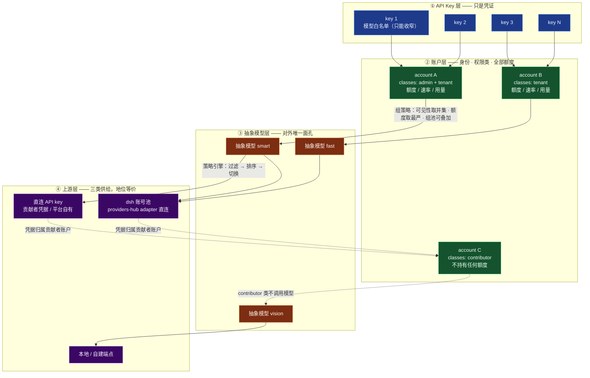
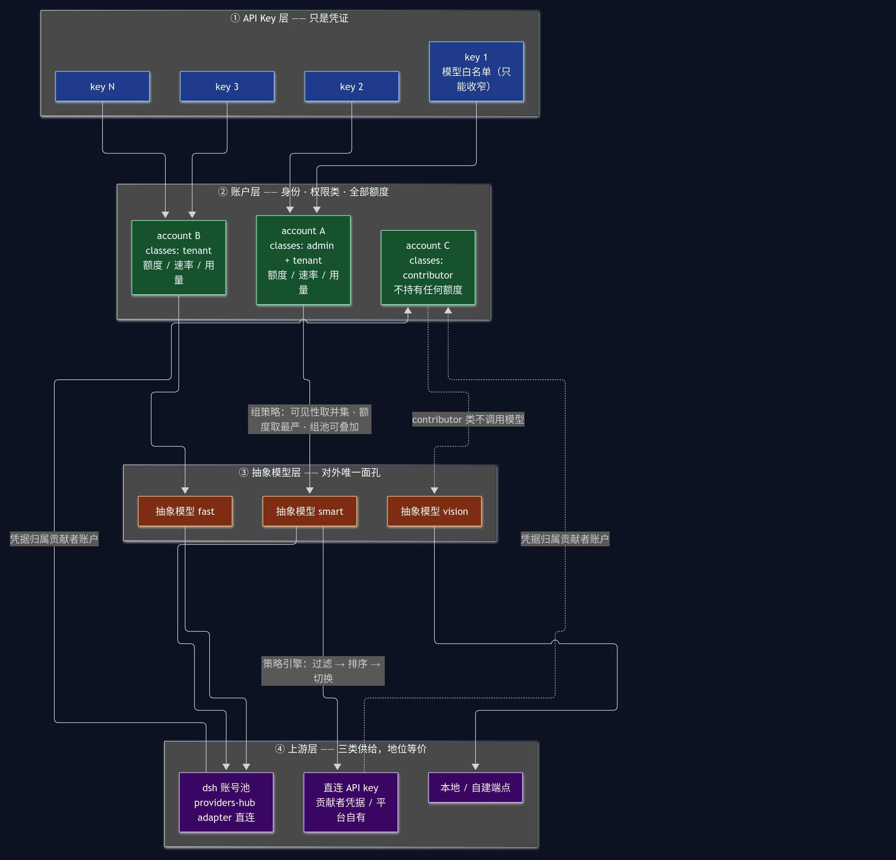
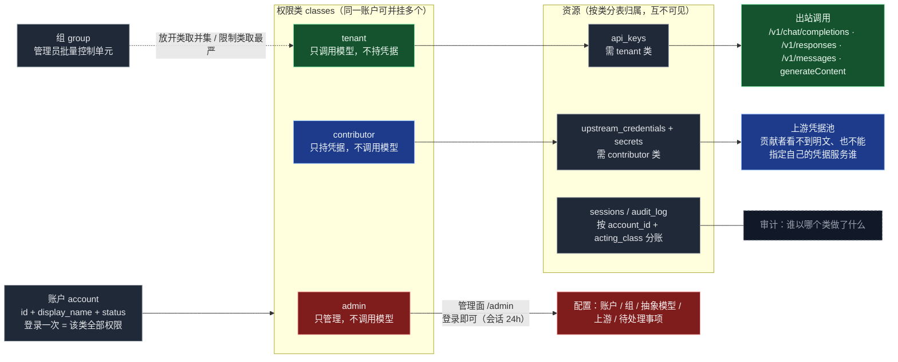
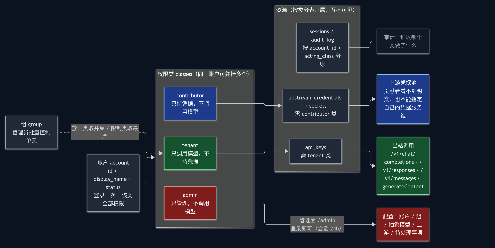
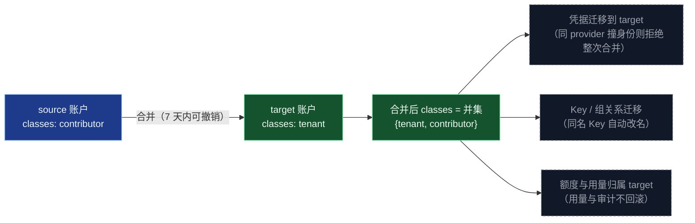
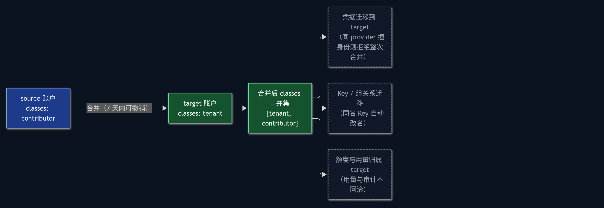

> 分册：架构 · 依赖：[01-overview.md](01-overview.md) · 对应总纲：[PLAN.md](../PLAN.md) 第 6 章

# 架构图（模型调用层级 · 权限架构）

本册只有两张图，是全库的**图形总索引**。文字定义分别在
[01-overview.md](01-overview.md)（分层与进程）、[../security/01-accounts.md](../security/01-accounts.md)
（账户与权限类）、[../security/03-groups.md](../security/03-groups.md)（组）、
[../models/02-abstract.md](../models/02-abstract.md)（抽象模型）、
[03-upstream.md](03-upstream.md)（上游）。**图与文字冲突时以文字为准**，图只负责建立整体印象。

---

## 1. 模型调用层级图

这张图回答一个问题：**一次请求从进来打到上游，经过哪几层，每层各决定什么。**

### 1.1 读图要点

| 观察 | 含义 |
|---|---|
| **Key 没有自己的额度** | Key 只是「凭证 + 可收窄的模型白名单」。日/月 token、Credits、并发全都挂在**账户**上，这个账户的所有 Key 共享同一份额度。这样"多把 Key 等于偷偷放大额度"这条路根本不存在 |
| **Key 层与模型层不嵌套** | 图中 `① → ②` 是身份汇聚，真正的路由是 `② → ③ → ④`。Key 的两个产物（`account_id`、白名单）只是**过滤器**进入策略引擎 |
| **账户层是分叉点** | 同一账户既可能"调模型"（`tenant` 类）、又可能"只供凭据"（`contributor` 类）、还可能"只管理"（`admin` 类）。一条账户可挂多个类，所以图上同一节点向右有多条去向 |
| **额度只跟 tenant 类走** | `contributor` 不调模型，所以不持有额度；`admin` 只管理，也不消耗额度（管理员要调模型靠同一个账户挂的 `tenant` 类） |
| **模型层是唯一对外面孔** | 客户端只会看到 `smart` / `fast` 这类抽象模型名；真实模型名与渠道不出现在任何客户端可见字段 |
| **上游三类地位等价** | 直连 API key、dsh 账号池、本地端点都实现同一个 `Upstream` 接口，差异只在"凭据从哪来"与"执行体是什么"。路由与协议转换**不区分**来源 |
| **虚线是归属关系不是数据流** | `S1/S2 -.-> A3` 表示凭据所有权，不是请求路径。请求走 `② → ③ → ④`，凭据**不可被调用方指定** |

### 1.2 四个问题的归属（谁决定什么）

| 问题 | 由谁决定 | 不由谁决定 |
|---|---|---|
| 这个请求能不能进来 | L1 鉴权 + 限速 + 账户额度 | 策略引擎 |
| 用哪个抽象模型 | 入站请求里的 `model` 字段 + 弃用链解析 | Key、上游 |
| 抽象模型怎么落到真实模型 | 策略引擎（过滤 → 排序） | L1、上游 |
| 具体用哪条凭据 | 运行时展开候选时选择 | 调用方、贡献者本人 |
| 中途失败了换不换 | `call` 状态机（**已吐可见内容则不换**） | 策略引擎 |

### 1.3 排序策略（内置四种）

| 策略 | 按什么排 | 数据来源 |
|---|---|---|
| `expiry-first` | 最快作废的额度先用 | 各渠道的到期时间探测 |
| `balance` | 余额最少的先用 | 余额查询 |
| `speed` | 最近延迟最低的先用 | 滚动统计 |
| `price` | Credits 折算最便宜的先用 | 内置价格表 × 模型 |

默认链 `[expiry-first, balance]`：先用快过期的，同到期时间再比余额。理由——额度到期作废是真实损失，
余额少说明这个渠道本来就快用完了，两者都指向"先把它用掉"。`speed` / `price` 是可选的首位策略，
管理员按渠道特性自己换。

---

## 2. 权限架构图

这张图回答一个问题：**谁能做什么、看不到什么、隔离发生在哪里。**

### 2.1 读图要点

| 观察 | 含义 |
|---|---|
| **账户是唯一主体，权限类是挂件** | 没有"租户账户""贡献者账户"三种实体，只有一个 `accounts` 表；一个人的身份是他挂了哪些类 |
| **三类能力互不授予** | `admin` 不因为能改配置就获得调模型的权力；`tenant` 不因为能调模型就获得持凭据的权力。这是"彻底隔离"的准确含义——隔离发生在**类之间**，不是"人不能有多种身份" |
| **没有类级提权** | 登录一次即获得该账户所有类的全部权限，会话有效期默认 **24 小时**。管理面与调用面共用一次登录，不存在"再验一次"的中间态 |
| **两张资源表不互通** | `api_keys` 与 `upstream_credentials` 归属不同的类，任何一类都读不到另一类的表。管理员在管理面上能看到元数据（谁贡献了什么渠道、健康度），但**没有接口返回凭据明文** |
| **组只作用于 tenant** | 组的策略（模型可见性、每人额度、组共享池、Key 上限）全都约束"调模型"这件事；`contributor` 不调模型，所以组对它无意义 |
| **审计按 `account_id + acting_class` 分账** | 同一账户用 `tenant` 类发起的调用与用 `admin` 类做的配置变更，在审计里是两条不同的记录 |

### 2.2 合并后的权限继承

**为什么类取并集而不是取其一**：合并的语义是"这两个身份是同一个人"，而不是"其中一个身份作废"。
作废其中一类会让被合并方的资源变成孤儿（凭据没有归属、Key 没有主人）。
撤销（7 天内）只拆回类归属与资源归属，不动已发生的用量与审计。

---

## 3. 与其它分册的关系

| 想看什么 | 去哪 |
|---|---|
| 分层职责、进程模型、部署形态 | [01-overview.md](01-overview.md) |
| IR 与四协议映射 | [02-ir.md](02-ir.md) |
| 上游三类怎么实现、健康与重试 | [03-upstream.md](03-upstream.md) |
| Node sidecar 的 IPC 契约 | [04-sidecar.md](04-sidecar.md) |
| 账户、权限类、合并 | [../security/01-accounts.md](../security/01-accounts.md)、[../security/02-authn.md](../security/02-authn.md) |
| 组的策略与合并语义 | [../security/03-groups.md](../security/03-groups.md) |
| 授权判定的完整规则 | [../security/04-authz.md](../security/04-authz.md) |
| 抽象模型、策略引擎、弃用链 | [../models/02-abstract.md](../models/02-abstract.md)、[../models/03-strategy.md](../models/03-strategy.md)、[../models/04-deprecation.md](../models/04-deprecation.md) |
